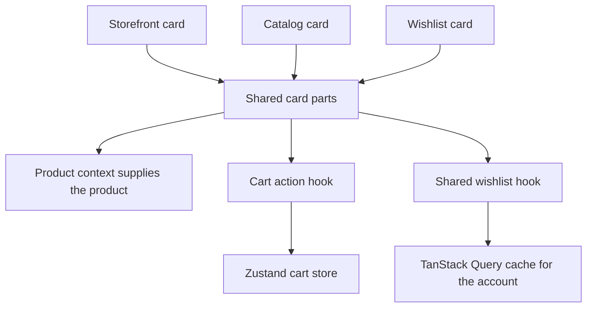
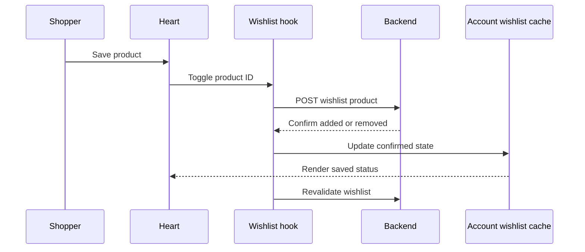

# Frontend composition refactor explained

Date: 2 November 2026  
Project: Amazon inspired e commerce storefront  
Approach: Vercel React Composition Patterns

## What this change accomplishes

The product cards and navbar now separate reusable presentation from the code that manages shopping actions. Storefront, catalog and wishlist cards compose shared pieces explicitly. The navbar composes account, delivery and cart components, each with a smaller responsibility.

For the shopper, adding to cart still updates the cart count and shows a toast while keeping the current page visible. Saved hearts now reflect the account's shared wishlist. The wishlist page reads the actual backend response and provides one remove button per card.

The main benefit is easier maintenance and more consistent behavior. This is an architecture refactor with related wishlist corrections. It does not establish a measured improvement in page speed or Core Web Vitals.

## Product cards before and after

Previously, `ProductCard.jsx` performed cart API requests, managed a local wishlist flag, selected layout differences and rendered the entire card. Its catalog variant checked the same mode in several places, including the price size, availability text, button style and cart icon.

Now `ProductCard.jsx` defines three explicit compositions:

| Component | Where it is used | What it composes |
| --- | --- | --- |
| `StorefrontProductCard` | Homepage product rows and related products | Heart, image, details, regular price, stock warning and orange cart button with icon |
| `CatalogProductCard` | Catalog grid | Heart, image, details, larger price, availability, stock warning and yellow cart button |
| `WishlistProductCard` | Saved products page | Remove control, image, details, regular price, stock warning and cart button |

The shared pieces live in `components/product/ProductCardParts.jsx`. A card root supplies its product through a local React context. Child parts read that product using React 19's `use()` API. The context only supplies the current product; cart and wishlist data continue to have their own existing owners.

**By sharing the price part, a future price-formatting change can be made once and used by all three layouts.** By composing the wishlist remove control directly, the saved-products page no longer needs to position a second button over an existing heart.

Each rendered card gets an instance-specific ID, so the same product can appear in multiple collections without duplicating its root ID. The default `ProductCard` export remains as a compatibility wrapper for existing consumers; application call sites use the explicit compositions.

## How adding to cart now works

The cart button delegates behavior to `hooks/useProductCartAction.js`. That hook uses the existing cart store's `addItem` action, rather than repeating the request inside card markup.

For example, when a signed-in shopper presses Add to Cart on a catalog card:

1. The hook checks stock and blocks another submit from that button while the request is pending.
2. The cart store posts the product ID and quantity to `/cart/items`.
3. The store refreshes the cart and updates its count.
4. The navbar cart component receives the count change through its store subscription.
5. A success toast appears. The catalog remains visible and the cart drawer stays closed.

If the request fails, the hook reports the error and releases the button for retry. If the shopper is signed out, the action redirects to `/login?redirect=/products/<slug>` so sign-in retains the product destination. A session revision check prevents a completed old-session action from showing feedback for a different account.

**By putting the action in a hook and leaving its appearance in the button part, the catalog and storefront buttons share behavior while keeping their different styles.**

The existing store remains responsible for cart synchronization and account isolation. Product-detail Buy Now and order-history Buy it again continue through their existing flows, covered by the regression suite.

## How the shared wishlist works

The backend's `GET /wishlist` controller returns its records directly in the response's `data` array. The old hook attempted to read `data.items`, causing a populated wishlist to be treated as empty. The revised hook reads the array that the controller actually returns. An unused duplicate wishlist hook was removed from `useProducts.js` so there is one implementation to maintain.

Wishlist data is cached under `['wishlist', userId]`. Card hearts and the wishlist page observe the same account-specific query. Multiple cards share the cached data and in-flight read. Guest cards do not fetch the private wishlist.

For example, if the same product appears in a homepage collection and another visible product row:

1. Both hearts read their saved status from the same account query.
2. Clicking a heart calls the existing wishlist service.
3. The backend confirms an `added` or `removed` action.
4. The hook updates the shared cache from that confirmation.
5. All observing hearts display the new saved state, and the query revalidates against the server.

**By reading shared data instead of a local `wishlisted` boolean, a newly mounted card can show an already-saved product correctly.** A failed toggle leaves the previously known state intact and allows retry. If the initial wishlist read fails, the heart position shows a retry control so a click reloads the list before trying to change an unknown state.

The wishlist page also reports read failures with a retry action instead of claiming the list is empty. Its dedicated cards render one remove control plus Add to Cart. Remove buttons remain disabled while the page's removal is pending.

Writes capture the current session revision. A late response from a previous account is ignored when updating cache and showing feedback. Reads accept an abort signal, allowing TanStack Query to cancel obsolete requests. Existing session-reset behavior remains in place.

These are client-side synchronization improvements. They do not make the backend toggle endpoint atomic across devices, introduce server-pushed updates or promise instantaneous synchronization between separate browsers. Existing refresh and cross-tab infrastructure still applies.

## How the navbar now works

`Navbar.jsx` now assembles the header and handles route-specific layout and back navigation. Its extracted components have these responsibilities:

| File | Responsibility |
| --- | --- |
| `NavbarAccount.jsx` | Account menu, mobile account link, order link and sign-out behavior |
| `NavbarCartLink.jsx` | Cart count and fetching the cart when the authenticated account changes |
| `NavbarDelivery.jsx` | Desktop and phone delivery controls |
| `useDeliveryLocation.js` | One selected delivery location, modal state and local persistence |

The desktop and phone delivery controls receive the same selected location and open the same modal. Selecting a verified PIN updates both controls and persists the selection. Restored selections still require the verified marker and valid PIN, city and state fields. Postal lookup validation remains in the existing modal flow.

The navbar previously subscribed to whole auth and cart stores. The extracted components select only fields they use. The cart component observes the count and stable fetch action; account components observe authentication, name or role as needed. The outer navbar no longer observes the cart store.

**By moving the cart subscription into the cart component, changing the cart count updates that component without forcing the navbar search to render again.** A regression test verifies this specific behavior, including after sign-in. This is evidence about component updates, not a page-speed benchmark.

Sign-out still attempts server logout and clears the local session even if the server request fails. A revision check prevents a delayed logout response from signing out a subsequently established account.

## Appearance and responsive behavior

The refactor retains the current CSS classes, responsive style files and header element order. The desktop delivery control is now a semantic button, making it keyboard-operable. The dark phone home header, compact inner-page headers, search suggestions, delivery strip and bottom navigation retain their existing layout rules.

The festival carousel, banner artwork, collection arrangement, images, INR prices and fixed English region display remain in their existing implementations. No frontend dependency, backend endpoint or database migration was added.

Automated tests cover route-aware header behavior, back destinations and existing phone navigation. A pixel-level check on real phone, tablet and desktop viewports remains outstanding: the browser host and native connection were unavailable during this session. Preserving the CSS and DOM structure reduces layout risk but is not visual verification.

## Verification and practical limits

Final verification on 2 November 2026:

| Check | Result |
| --- | --- |
| Frontend automated suite | 92 tests passed across 26 files |
| New composition regression coverage | 15 tests passed across 2 new files |
| Frontend production build | Passed without build warnings |
| Responsive browser visual check | Unavailable because the browser host and native connection could not connect |

Run the checks from `Frontend/` with `npm test` and `npm run build`. On Windows PowerShell with script execution restricted, use `npm.cmd test` and `npm.cmd run build`.

The regression suite covers existing storefront behavior plus shared wishlist reads, synchronized hearts, the single remove control, retry paths, guest destinations, duplicate pending submits, account changes, delivery persistence and navbar update isolation.

The tests use mocked API responses matching the existing controllers. They do not prove live provider availability or exercise a real payment. Backend code was unchanged.

For a future visual check, use the existing development servers and inspect the homepage, catalog, wishlist and an inner page at phone, tablet and desktop widths. Confirm that search remains usable, cards retain their expected spacing, delivery controls agree and the fixed bottom navigation clears the page content.

## Files to start with when making future changes

- Change what a card includes in `Frontend/src/components/product/ProductCard.jsx`.
- Change shared card markup in `Frontend/src/components/product/ProductCardParts.jsx`.
- Change card cart behavior in `Frontend/src/hooks/useProductCartAction.js`.
- Change wishlist reads and writes in `Frontend/src/hooks/useWishlist.js`.
- Change the header composition in `Frontend/src/components/layout/Navbar.jsx`, then its account, cart or delivery component as appropriate.

The guiding rule is to compose the pieces a screen needs, and keep each kind of shared data with one owner. For this implementation, product context supplies a card's product, Zustand owns the cart, TanStack Query owns the account wishlist and the delivery hook owns the selected location.

## Catalog Buy Now addition

Catalog cards now compose Buy Now directly after Add to Cart. ProductCardParts.Root provides a shared action context backed by useProductCartAction, so both buttons use one pending guard and disable together during a write. Buy Now adds one unit to the existing cart, refreshes it and navigates to /checkout; checkout includes any items already in that cart. Add to Cart still keeps the shopper on the grid. Guests are sent to sign-in with the selected product return route; failed writes remain on the grid and allow retry. Out-of-stock purchases and old-session completion redirects are blocked.

Verified 98 tests, production build, desktop/phone placement and guest navigation. No order or payment was made.
