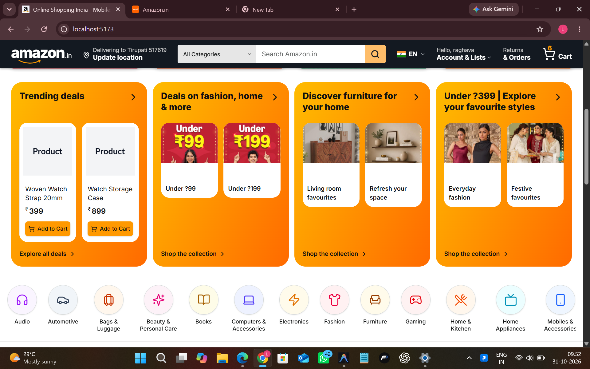

# Product image rollout plan

Date: 2026-10-31. Status: planned; no images downloaded or changed.

## Scope and visual direction

Cover all 221 products in 17 categories. Minimum three distinct images per product (663 images), preferred four (884 images). Existing image rows must first be audited; placeholders do not count toward coverage.

Use Amazon listings as visual references for framing, angles and gallery structure. Source actual assets from owned photography, supplier/manufacturer assets with reuse permission, or licensed stock that matches the product. Record the source and reuse permission; do not hotlink Amazon CDN images. Generic demo products must not be represented as a specific branded model with different specifications. Books need a matching licensed cover or an original clearly fictional demo cover, never an unrelated published book.

References:
- https://sell.amazon.com/blog/product-photos
- https://sellercentral.amazon.com/help/hub/reference/external/G200216080?locale=en-US

## 1. Audit and build an image manifest

Export each product ID, slug, category, description, existing image IDs/URLs and current image order. Check existing files for reachability, placeholder content, relevance and duplicate views. Keep useful images.

Create a manifest with productSlug, slot (1�4), role, Amazon reference URL, asset source URL, permission/provenance, local filename, checksum, dimensions, alt text, review status and final uploaded URL. Track needs-reference, needs-assets, ready, uploaded and verified per product. Use slugs rather than assumed database IDs.

## 2. Define each gallery

1. Main: clear product-only view on white, with consistent framing and no promotional text.
2. Alternate: side, rear or three-quarter angle of the same item and variant.
3. Detail: useful close-up of controls, ports, material, stitching or another real feature.
4. Optional context: realistic use, scale, included components or verified dimensions.

Do not turn one image into several nominal images with trivial crops. Keep colour, materials, accessories and specifications consistent across all views. Never invent certification marks, measurements, features or included accessories.

Category variations:
- Electronics, computers, mobiles, audio and gaming: front, rear/ports, controls, desk/use context.
- Fashion, bags and wearables: front, back/side, fabric/closures, worn or scale view.
- Home, appliances, furniture, automotive and office: full item, alternate angle, construction/detail, use context.
- Beauty: front packaging, back label, applicator/texture, actual contents; no invented label claims.
- Books: matching front cover, back cover, permitted interior spread and optional spine view.
- Toys and sports: complete item/set, alternate angle, components/detail, safe use context.

## 3. Pilot before bulk collection

Start with one product per category: 17 products and 51�68 images. Establish consistent product matching, backgrounds, file quality and gallery ordering. Inspect the pilot on catalog cards and detail pages before expanding.

## 4. Asset preparation

Use 1600�2000px square source canvases where available, preserve aspect ratio and avoid upscaling low-resolution downloads. Prepare WebP/JPEG derivatives with a proposed delivery target of 150�350KB, preserving useful detail. Existing backend accepts a maximum of 5MB per file and up to 10 files per request.

Name assets products/<product-slug>/01-main.webp, 02-angle.webp, 03-detail.webp, 04-context.webp. Keep source files outside the public delivery directory. Validate decoded image content, dimensions, file size and checksums. Add descriptive alt text.

## 5. Make image management deterministic

Existing support: ProductImage relation, POST /api/products/:id/images, image deletion, Cloudinary with local uploads fallback, and a frontend gallery with thumbnails and zoom.

Before bulk import:
- Add explicit sortOrder to ProductImage, backfill existing ordering by ID and return images ordered by sortOrder then ID. Slot one becomes the catalog cover.
- Enable image upload, removal, reorder and cover selection for existing products in the admin editor. Current edit form does not provide a complete gallery management workflow.
- Persist alt text and use it in the gallery.
- Standardize image URL resolution and provide a real local fallback asset; the gallery currently references /placeholder.png.
- Introduce a manifest-driven importer with dry-run, small batches, retries, checksum-based deduplication, resumability and a per-product report. Preserve original image rows until replacement uploads succeed. Clean up newly uploaded orphan files after failed database writes.

## 6. Roll out and preserve seed reproducibility

Upload category by category, 13 products at a time (39�52 images per category). Reuse approved existing images. Save new URLs, image roles and ordering in the manifest. Update product_images.csv and its importer to retain ordering/alt text, and update manifest.json counts. Remove superseded placeholder seed rows only after replacements are verified so future imports cannot recreate placeholders.

Back up original image associations before replacement. Avoid deleting original stored assets during rollout so associations can be restored if needed.

## 7. Acceptance checks

- All 221 products have at least three approved distinct images; target four where useful.
- Images depict the same product and variant and match the listing description.
- No broken URLs, placeholders, accidental duplicates or cross-product assignments.
- Catalog cover and thumbnail order remain stable across reloads.
- Alt text, mobile swipe, desktop thumbnails, zoom and fallback behaviour work.
- Responsive image delivery, lazy loading of secondary views and layout dimensions prevent avoidable performance regressions.
- Existing prices, stock, product IDs, categories, carts and orders remain unchanged.
- Re-running the importer adds no duplicates. Verify ordered-image API responses and importer retry behaviour, then run frontend/backend tests and a frontend build.

Deliverables: reviewed manifest, 663�884 approved images, repeatable importer, admin gallery management, updated seed data and coverage report.
