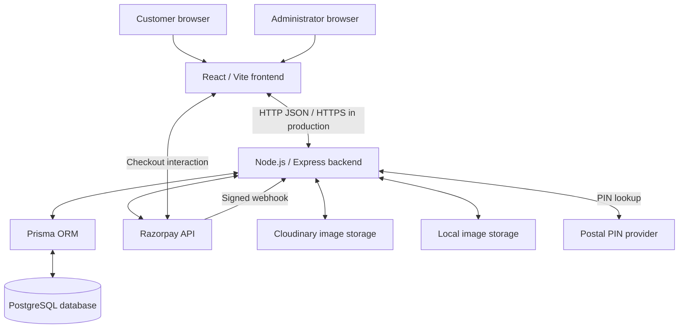
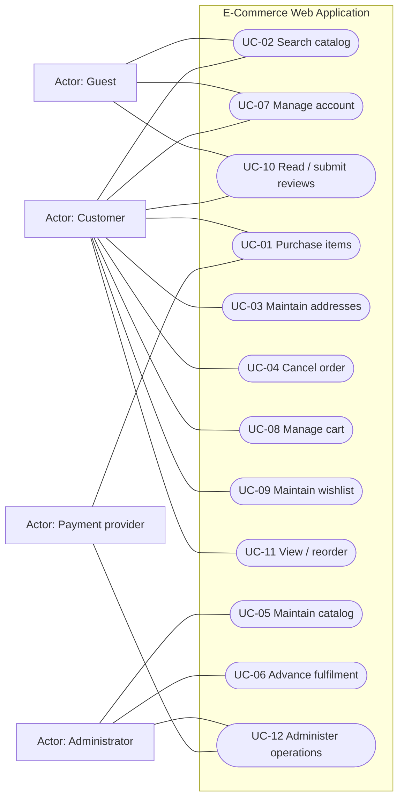
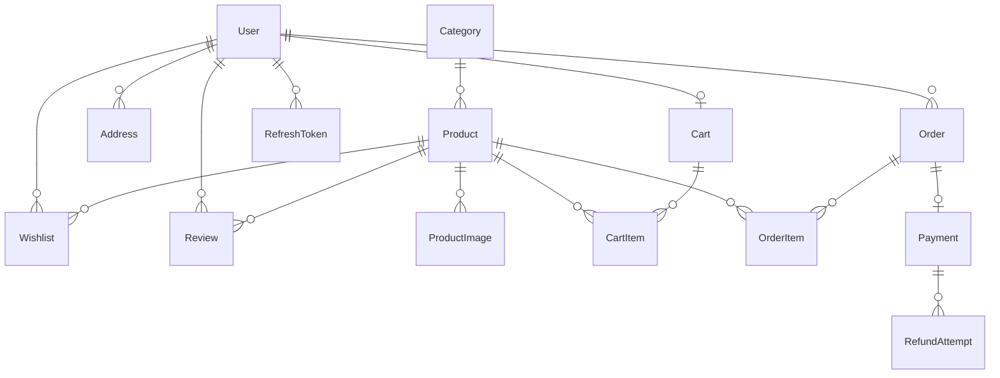
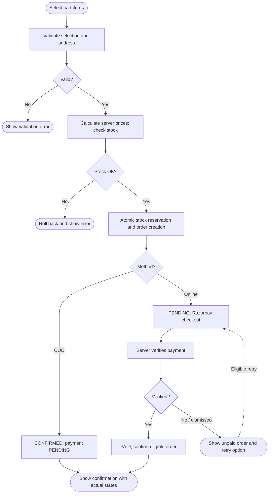
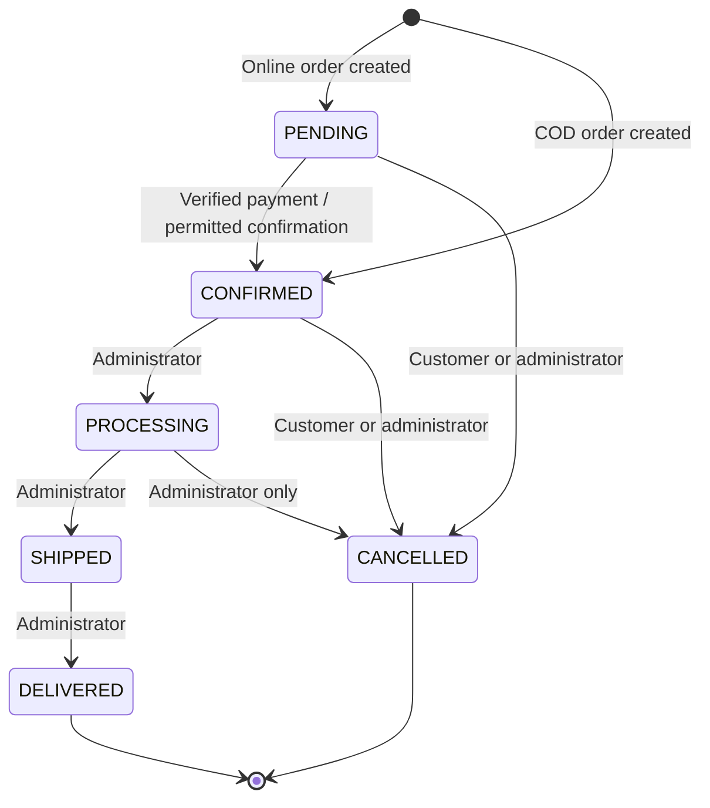

*Table 1. Submission details*

| Submission field       | Details     |
| ---------------------- | ------------------ |
| Submitted by           | Arella Raghavendra |
| Register / Roll Number | R220348            |
| Year & Dept.           | E-03 & CSE        |
| Section              | D                  |
| University             | RGUKT RK Valley    |
| Project Guide          | Lingamurthy        |
| Academic Year          | 2026-2027          |
| Status                 | Final submission; faculty approval pending |

<!-- COVER PAGE ENDS: exporters start document control on a new page. -->

**Document details**

Software Requirements Specification for the E-Commerce Web Application. Final submission edition, version 1.0. Prepared on 12 November 2026. This specification defines the project scope, required behaviour, interfaces, data and planned acceptance conditions. Final submission identifies this document edition; it does not assert faculty approval or completed application acceptance testing.

**Contents**

- [1. INTRODUCTION](#1-introduction)
  - [1.1 Purpose](#11-purpose)
  - [1.2 Project Scope](#12-project-scope)
  - [1.3 Intended Audience](#13-intended-audience)
  - [1.4 Project Objectives](#14-project-objectives)
  - [1.5 Definitions and Abbreviations](#15-definitions-and-abbreviations)
  - [1.6 References](#16-references)
  - [1.7 Document Overview](#17-document-overview)
- [2. OVERALL DESCRIPTION](#2-overall-description)
  - [2.1 Product Perspective](#21-product-perspective)
  - [2.2 User Classes](#22-user-classes)
  - [2.3 Operating Environment](#23-operating-environment)
  - [2.4 Assumptions and Dependencies](#24-assumptions-and-dependencies)
  - [2.5 Constraints](#25-constraints)
- [3. FUNCTIONAL REQUIREMENTS](#3-functional-requirements)
  - [3.1 Requirement Conventions](#31-requirement-conventions)
  - [3.2 Functional Requirement Register](#32-functional-requirement-register)
    - [3.2.1 Requirements FR-01 to FR-13](#321-requirements-fr-01-to-fr-13)
    - [3.2.2 Requirements FR-14 to FR-26](#322-requirements-fr-14-to-fr-26)
    - [3.2.3 Requirements FR-27 to FR-39](#323-requirements-fr-27-to-fr-39)
  - [3.3 Inputs and Acceptance Conditions](#33-inputs-and-acceptance-conditions)
    - [3.3.1 Acceptance conditions FR-01 to FR-13](#331-acceptance-conditions-fr-01-to-fr-13)
    - [3.3.2 Acceptance conditions FR-14 to FR-26](#332-acceptance-conditions-fr-14-to-fr-26)
    - [3.3.3 Acceptance conditions FR-27 to FR-39](#333-acceptance-conditions-fr-27-to-fr-39)
  - [3.4 Checkout Requirements](#34-checkout-requirements)
- [4. EXTERNAL INTERFACE REQUIREMENTS](#4-external-interface-requirements)
  - [4.1 Interface Scope](#41-interface-scope)
  - [4.2 Interface Contracts](#42-interface-contracts)
- [5. NON-FUNCTIONAL REQUIREMENTS](#5-non-functional-requirements)
  - [5.1 Security integrity and evaluation targets](#51-security-integrity-and-evaluation-targets)
  - [5.2 Usability protection and operations](#52-usability-protection-and-operations)
  - [5.3 Proposed Evaluation Conditions](#53-proposed-evaluation-conditions)
- [6. DATA REQUIREMENTS](#6-data-requirements)
  - [6.1 Initial Data Dictionary](#61-initial-data-dictionary)
  - [6.2 Field Types and Business Rules](#62-field-types-and-business-rules)
  - [6.3 Ownership and Relationships](#63-ownership-and-relationships)
  - [6.4 Entity Relationship Model](#64-entity-relationship-model)
- [7. USE CASES AND SYSTEM MODELS](#7-use-cases-and-system-models)
  - [7.1 Use Case Register](#71-use-case-register)
  - [7.2 UML Use Case View](#72-uml-use-case-view)
  - [7.3 UC-01 Purchase selected cart items](#73-uc-01-purchase-selected-cart-items)
  - [7.4 UC-02 Search and filter products](#74-uc-02-search-and-filter-products)
  - [7.5 UC-03 Maintain a delivery address](#75-uc-03-maintain-a-delivery-address)
  - [7.6 UC-04 Cancel an eligible order](#76-uc-04-cancel-an-eligible-order)
  - [7.7 UC-05 Maintain product information](#77-uc-05-maintain-product-information)
  - [7.8 UC-06 Advance order fulfilment status](#78-uc-06-advance-order-fulfilment-status)
  - [7.9 UC-07 Register, sign in and maintain an account](#79-uc-07-register-sign-in-and-maintain-an-account)
  - [7.10 UC-08 Manage a shopping cart](#710-uc-08-manage-a-shopping-cart)
  - [7.11 UC-09 Maintain a wishlist](#711-uc-09-maintain-a-wishlist)
  - [7.12 UC-10 Read and submit product reviews](#712-uc-10-read-and-submit-product-reviews)
  - [7.13 UC-11 View order history and buy again](#713-uc-11-view-order-history-and-buy-again)
  - [7.14 UC-12 Administer payments, users and operations](#714-uc-12-administer-payments-users-and-operations)
  - [7.15 Checkout Activity Model](#715-checkout-activity-model)
  - [7.16 Order Fulfilment State Model](#716-order-fulfilment-state-model)
- [8. ACCEPTANCE CRITERIA AND TRACEABILITY](#8-acceptance-criteria-and-traceability)
  - [8.1 Functional Requirements Traceability Matrix](#81-functional-requirements-traceability-matrix)
  - [8.2 Non-Functional Requirements Traceability Matrix](#82-non-functional-requirements-traceability-matrix)
  - [8.3 Evidence Records](#83-evidence-records)
- [9. REVIEW AND APPROVAL](#9-review-and-approval)
  - [9.1 Outstanding Agreements](#91-outstanding-agreements)
  - [9.2 Review and Approval](#92-review-and-approval)

## 1. INTRODUCTION

### 1.1 Purpose

This Software Requirements Specification defines the expected behaviour and quality requirements of the E-Commerce Web Application. It describes the facilities provided to guests, registered customers and administrators, together with the system's external interfaces, data requirements and constraints. The document provides a common reference for project evaluation, development and testing.

### 1.2 Project Scope

The E-Commerce Web Application provides a browser-based platform through which customers can discover products, manage a shopping cart and wishlist, maintain delivery addresses, place orders and view order progress. Customers can choose online payment through Razorpay or Cash on Delivery. Administrators manage the product catalog, inventory, orders and user roles through a restricted administration area.

The project scope includes:

- Account registration, sign-in, profile management and password changes.
- Product browsing, search, category and price filters, sorting and product details.
- Product images, selling prices, original prices and applicable discounts.
- Shopping cart quantities and selection of items for checkout.
- Saved delivery addresses and a separate delivery PIN location lookup.
- Online payment, Cash on Delivery, order history and eligible order cancellation.
- Wishlists, product reviews and rating summaries.
- Administrative catalog, stock, order, user and system-health functions.

Proposed exclusions to confirm with the project guide: a multi-vendor seller portal, live courier GPS tracking, customer wallets and native Android/iOS applications. A responsive website is included.

Real stock-alert delivery is outside this release: the out-of-stock Notify me control is a labelled demonstration and does not register a subscription or send a notification.

### 1.3 Intended Audience

The intended readers are the student project team, project guide, academic evaluators, developers and testers.

### 1.4 Project Objectives

The project aims to let customers purchase selected catalog items, preserve accurate order and stock records, and let administrators maintain the catalog and fulfil orders.

### 1.5 Definitions and Abbreviations

*Table 2. 1.5 Definitions and Abbreviations*

| Term                 | Meaning                                                                   |
| -------------------- | ------------------------------------------------------------------------- |
| SRS                  | Software Requirements Specification                                       |
| FR                   | Functional Requirement: behaviour the system must provide                 |
| NFR                  | Non-Functional Requirement: a quality or constraint the system must meet  |
| COD                  | Cash on Delivery                                                          |
| INR                  | Indian Rupee                                                              |
| API                  | Application Programming Interface                                         |
| PIN                  | Postal Index Number used for Indian postal locations                      |
| Acceptance criterion | An observable condition used to decide whether a requirement is satisfied |
| TBD                  | To be determined before the document is finalised                         |

*Table 3. 1.5 Definitions and Abbreviations*

| Term           | Meaning                                                                  |
| -------------- | ------------------------------------------------------------------------ |
| INT            | External interface identifier                                            |
| UC             | Use case identifier                                                      |
| AT             | Acceptance check identifier                                              |
| MRP            | Maximum Retail Price; a stored original price is not a verified manufacturer MRP |
| ORM            | Object-relational mapper; Prisma provides the application data interface |
| JWT            | JSON Web Token used by authentication                                    |
| Fulfilment     | Order processing and delivery progress                                   |
| Refund pending | Repayment has not yet been confirmed complete by the gateway             |

### 1.6 References

The original draft and project documentation are internal project references. Implementation files below were inspected for alignment; their presence does not prove a requirement has passed testing.

*Table 4. 1.6 References*

| Reference | Document / source                                                      | Purpose                                                                   |
| --------- | ---------------------------------------------------------------------- | ------------------------------------------------------------------------- |
| REF-01    | [SRS version 0.3](SRS_DRAFT.md)                                         | Preserved requirements baseline                                           |
| REF-02    | [Project memory](../AGENTS.md)                                          | Historical decisions and project context                                  |
| REF-03    | [Frontend plan](FRONTEND_PLAN.md)                                       | Internal interface and feature plan                                       |
| REF-04    | [Original backend plan](Backend/ecommerce_backend_plan.md)              | Historical API design context                                             |
| REF-05    | [Prisma schema](../Backend/prisma/schema.prisma)                        | Entity and relationship verification                                      |
| REF-06    | [Order service](../Backend/src/services/order.service.js)               | Checkout, cancellation and state transitions                              |
| REF-07    | [Input validators](../Backend/src/validators)                           | Field rules and validation boundaries                                     |
| REF-08    | [SRS documentation skill](../.agents/skills/srs-documentation/SKILL.md) | IEEE 830-style organizational guidance; not a formal standards assessment |
| REF-09    | [Design review](SRS_DESIGN_REVIEW.md)                                   | Formatting findings and implementation discrepancies                      |

### 1.7 Document Overview

Chapters 1–2 establish scope, actors and constraints. Chapters 3–6 specify behaviour, interfaces, quality and data. Chapter 7 describes workflows and system models. Chapter 8 preserves acceptance-check mappings. Chapter 9 records outstanding agreements and the review process.

## 2. OVERALL DESCRIPTION

### 2.1 Product Perspective

The application consists of a responsive web storefront, a restricted administration interface, a backend API and a relational database. It integrates with external services for online payments, image storage and postal PIN lookup.

*Figure 1. High-level system architecture*

Browsers use the frontend and backend API. Prisma connects the backend to PostgreSQL; browsers have no direct database path. Razorpay handles the customer checkout interaction and sends signed notifications to the backend. Cloudinary and local storage represent configured image-storage options.

[Rendered figure](SRS_FIGURES/01-architecture.svg)

### 2.2 User Classes

*Table 5. 2.2 User Classes*

| User class    | Main responsibilities / capabilities                                                            |
| ------------- | ----------------------------------------------------------------------------------------------- |
| Guest         | Browse and search products, view product information and create an account or sign in           |
| Customer      | Manage their own profile, cart, wishlist, addresses, orders and reviews                         |
| Administrator | Manage catalog information, inventory, order processing, user roles and operational information |

Razorpay, Cloudinary and the postal lookup provider are external systems rather than human user roles.

*Figure 2. UML use-case view*

Rectangles identify actors and ellipses identify use cases within the system boundary. Solid associations indicate participation rather than processing order. Mermaid flowchart notation renders this UML-style view; no unsupported include, extend or inheritance relationships are asserted. Guests participate in reading reviews, while submission requires authentication. Payment-provider participation is limited to payment interaction and reconciliation within UC-01/UC-12.

[Rendered figure](SRS_FIGURES/02-use-cases.svg)

### 2.3 Operating Environment

The current project uses React and Vite for the frontend, Node.js and Express for the backend, and PostgreSQL with Prisma for data storage. The customer interface is in English and prices are displayed in INR. Supported browser versions, deployment hardware and the final evaluation environment are TBD.

### 2.4 Assumptions and Dependencies

- Users need a network connection to retrieve current catalog data and perform account, cart and order operations.
- Online payment depends on Razorpay availability and valid configuration.
- Cloudinary image uploads depend on configured credentials; the project also supports local upload storage.
- Delivery PIN lookup depends on the postal provider. A resolved postal location does not establish courier serviceability.
- Administrative functions require an authenticated account with the administrator role.

### 2.5 Constraints

- The delivery region is India; the interface language is English and monetary values use INR.
- The initial release is a responsive browser application with customer and administrator interfaces.
- The project uses React, Node.js/Express, PostgreSQL and Prisma. These are existing implementation constraints rather than customer-facing requirements.
- No dedicated scanner, printer or other specialist hardware interface is required. Invoice printing uses browser facilities.
- Local development supports separate frontend/backend processes and a root development startup command. Deployment also includes Docker configuration.
- Hardware capacity, supported browser versions, backup schedule and recovery responsibilities require agreement before final approval.

## 3. FUNCTIONAL REQUIREMENTS

### 3.1 Requirement Conventions

Each FR identifier denotes one preserved requirement. Mandatory statements use “The system shall”. Requirements and their proposed Must Have priority (M) await faculty approval. Section 3.2 contains the authoritative statements; Section 3.3 contains inputs, acceptance and failure details; Section 3.4 expands checkout. Chapter 8 retains the original acceptance-check identifiers. No listed check is marked passed.

### 3.2 Functional Requirement Register

#### 3.2.1 Requirements FR-01 to FR-13

*Table 6. 3.2.1 Requirements FR-01 to FR-13*

| Requirement ID | Module            | Requirement statement                                                                                                               | Priority |
| -------------- | ----------------- | ----------------------------------------------------------------------------------------------------------------------------------- | -------- |
| FR-01          | Registration      | The system shall allow a guest to register an account using valid registration details and an email address not already registered. | M        |
| FR-02          | Authentication    | The system shall allow a registered user to sign in using valid credentials.                                                        | M        |
| FR-03          | Catalog           | The system shall return products matching the customer's search and supported filter selections.                                    | M        |
| FR-04          | Product details   | The system shall display the selected product's stored description, images, price and availability.                                 | M        |
| FR-05          | Cart              | The system shall allow a customer to update a cart item's quantity within available stock limits.                                   | M        |
| FR-06          | Selected checkout | The system shall create an order containing only the cart items selected by the customer for checkout.                              | M        |
| FR-07          | Addresses         | The system shall allow a customer to save a delivery address associated with their own account.                                     | M        |
| FR-08          | Online payment    | The system shall verify an online payment with the configured payment gateway before marking the order as paid.                     | M        |
| FR-09          | Order history     | The system shall allow a customer to view orders belonging to their own account.                                                    | M        |
| FR-10          | Wishlist          | The system shall allow a customer to save a product to their wishlist.                                                              | M        |
| FR-11          | Reviews           | The system shall allow an authenticated customer to submit at most one review per product, with an integer rating from 1 to 5.      | M        |
| FR-12          | Administration    | The system shall restrict administrative operations to authenticated administrators.                                                | M        |
| FR-13          | Delivery location | The system shall apply a delivery PIN location only after a successful postal lookup.                                               | M        |

#### 3.2.2 Requirements FR-14 to FR-26

*Table 7. 3.2.2 Requirements FR-14 to FR-26*

| Requirement ID | Module                                 | Requirement statement                                                                                     | Priority |
| -------------- | -------------------------------------- | --------------------------------------------------------------------------------------------------------- | -------- |
| FR-14          | Account holder / logout                | The system shall terminate the current authenticated session when the account holder signs out.           | M        |
| FR-15          | Customer / profile                     | The system shall allow an authenticated customer to update their own supported profile fields.            | M        |
| FR-16          | Account holder / password              | The system shall allow an account holder to change their password after verifying their current password. | M        |
| FR-17          | Guest or customer / catalog order      | The system shall paginate catalog results using supported sorting choices.                                | M        |
| FR-18          | Customer / add cart item               | The system shall add a requested product quantity to the customer's cart when sufficient stock exists.    | M        |
| FR-19          | Customer / remove cart item            | The system shall remove the selected product from the customer's cart.                                    | M        |
| FR-20          | Customer / address update              | The system shall allow a customer to edit an address belonging to their own address book.                 | M        |
| FR-21          | Customer / address deletion            | The system shall allow a customer to delete an address from their own address book.                       | M        |
| FR-22          | Customer / COD checkout                | The system shall accept Cash on Delivery as a supported checkout method.                                  | M        |
| FR-23          | Customer / payment retry               | The system shall permit retrying payment for an eligible unpaid online order.                             | M        |
| FR-24          | Customer / cancellation                | The system shall allow a customer to cancel their own PENDING or CONFIRMED order.                         | M        |
| FR-25          | Administrator / refund initiation      | The system shall allow an administrator to initiate a refund for an eligible cancelled paid online order. | M        |
| FR-26          | Payment provider / refund confirmation | The system shall reconcile refund status from authenticated gateway notifications.                        | M        |

#### 3.2.3 Requirements FR-27 to FR-39

*Table 8. 3.2.3 Requirements FR-27 to FR-39*

| Requirement ID | Module                               | Requirement statement                                                                                           | Priority |
| -------------- | ------------------------------------ | --------------------------------------------------------------------------------------------------------------- | -------- |
| FR-27          | Administrator / COD collection       | The system shall allow an administrator to record cash collection for an eligible delivered COD order.          | M        |
| FR-28          | Customer / wishlist removal          | The system shall remove a saved product from the customer's wishlist on request.                                | M        |
| FR-29          | Customer / review retrieval          | The system shall display product reviews with pagination and aggregate ratings.                                 | M        |
| FR-30          | Administrator / catalog maintenance  | The system shall allow an administrator to create and update product records.                                   | M        |
| FR-31          | Administrator / product deletion     | The system shall allow product deletion only when historical data constraints permit it.                        | M        |
| FR-32          | Administrator / image management     | The system shall allow an administrator to upload supported product images.                                     | M        |
| FR-33          | Administrator / categories           | The system shall allow an administrator to maintain catalog categories.                                         | M        |
| FR-34          | Administrator / fulfilment           | The system shall restrict order status changes to permitted transitions.                                        | M        |
| FR-35          | Administrator / user directory       | The system shall provide a paginated user directory to administrators.                                          | M        |
| FR-36          | Administrator / operational overview | The system shall display order, revenue, user, product and low-stock information.                               | M        |
| FR-37          | Customer / order search              | The system shall allow customers to search and filter their own order history.                                  | M        |
| FR-38          | Customer / order details             | The system shall display a customer's order items, total, address snapshot, fulfilment state and payment state. | M        |
| FR-39          | Customer / buy again                 | The system shall allow a customer to add an available previously ordered product to their current cart.         | M        |

### 3.3 Inputs and Acceptance Conditions

The register states each required function. The following conditions define its inputs, expected result and failure handling. Private operations require an authenticated owner; administrative operations require the administrator role. Chapter 8 maps each requirement to its use case and acceptance check.

#### 3.3.1 Acceptance conditions FR-01 to FR-13

| Requirement | Inputs or trigger | Acceptance and failure behaviour |
| --- | --- | --- |
| FR-01 | Name, email, password, optional phone. | A valid unique account is created; duplicate email and invalid fields are rejected. Password rules are defined by FR-16. |
| FR-02 | Registered email and password. | Valid credentials establish an authenticated session; invalid credentials do not expose private data. |
| FR-03 | Search text, category, price and stock filters. | Returned products satisfy the requested criteria; no matches produce an explicit empty state. |
| FR-04 | Product slug. | Stored product information appears; an unknown slug produces a not-found state and unavailable images use a fallback. |
| FR-05 | Product and positive integer quantity. | The quantity and subtotal update within stock limits; invalid/excess quantities are rejected. |
| FR-06 | Selected cart item IDs, owned delivery address and payment method. | See Section 3.4 for the selected-item checkout conditions. |
| FR-07 | Recipient, phone, address, city, state, PIN and country. | A valid address is stored for the signed-in account; missing/invalid required values are rejected. |
| FR-08 | Application order and Razorpay verification values. | Only valid gateway/order/amount verification can mark payment paid; a duplicate confirmation does not duplicate stock or payment effects. |
| FR-09 | Signed-in customer and history request. | Paginated results contain only that customer's orders; guests require authentication. |
| FR-10 | Product identifier. | The item is saved once per account; a repeated toggle updates the saved state without duplicates. |
| FR-11 | Product, rating and optional comment. | A rating must be an integer from 1 to 5; a second review by the same account for that product is rejected. |
| FR-12 | Administrative request. | An authenticated administrator is authorized; guests and customer roles are rejected. |
| FR-13 | Six-digit Indian PIN. | Apply is enabled after a successful lookup; invalid codes and provider failures give an error. Postal validity does not imply shipping serviceability. |

#### 3.3.2 Acceptance conditions FR-14 to FR-26

| Requirement | Inputs or trigger | Acceptance and failure behaviour |
| --- | --- | --- |
| FR-14 | Sign-out action and current session. | Protected operations require sign-in after logout; account-specific cart and cached private data are cleared from the interface. |
| FR-15 | Own account identifier and supported profile fields. | Valid name/phone changes persist; invalid fields produce a validation message. Another customer's record cannot be changed. |
| FR-16 | Current password and new password. | A new password requires at least eight characters, an uppercase letter and a number; an incorrect current password is rejected. Existing sessions are revoked on success. |
| FR-17 | Sort field, direction, page and active filters. | Name, price and creation-date ordering follow the selected direction; page changes retain active filters. |
| FR-18 | Product identifier and requested quantity. | The cart count and totals update; a quantity exceeding stock is rejected without a partial cart write. |
| FR-19 | Product identifier in the current cart. | The product no longer appears and totals reflect the remaining items. |
| FR-20 | Owned address identifier and edited fields. | Valid changes persist; attempts to update another account's address are rejected. |
| FR-21 | Owned address identifier and delete action. | The address is unavailable for future checkout while earlier order address snapshots remain intact. |
| FR-22 | Selected cart items, owned address and COD method. | A successful COD order is confirmed with payment pending; Razorpay checkout is not required. |
| FR-23 | Eligible existing unpaid application order and payment retry. | An incomplete or failed payment does not appear as paid; a retry uses the eligible existing application order. |
| FR-24 | Owned order identifier and cancellation confirmation. | Other fulfilment states reject customer cancellation; successful cancellation restores reserved stock once. |
| FR-25 | Eligible cancelled paid online order and refund request. | The attempt is recorded and remains pending until gateway confirmation; failed or uncertain submission is not shown as a completed refund. |
| FR-26 | Signed gateway event with payment/refund identifiers. | A confirmed completion updates refund/payment records; duplicate or delayed notifications do not reverse completed state. Invalid signatures are rejected. |

#### 3.3.3 Acceptance conditions FR-27 to FR-39

| Requirement | Inputs or trigger | Acceptance and failure behaviour |
| --- | --- | --- |
| FR-27 | Eligible delivered COD order and collection action. | Collection marks payment paid and records the collection time and administrator; repeated collection does not record a second payment. |
| FR-28 | Saved product identifier and remove action. | The product disappears from the wishlist and saved indicators refresh. |
| FR-29 | Product identifier and requested review page. | Review pages belong to the selected product; rating counts cover all its reviews rather than only the visible page. |
| FR-30 | Validated product details, price, stock and category. | Valid names, descriptions, category assignments, prices and stock persist; invalid inputs return field errors. |
| FR-31 | Product identifier and delete request. | A product referenced by order history cannot be silently removed from that history; a blocked deletion gives a useful error. |
| FR-32 | Product identifier and supported multipart image file. | Accepted files become product image references; unsupported or excessive uploads return validation errors. |
| FR-33 | Category identifier or details and create/update/delete action. | Category names and slugs follow uniqueness rules; invalid references do not leave orphan products. |
| FR-34 | Order identifier and requested next fulfilment state. | Invalid transitions are rejected; unpaid online orders cannot advance through paid-order fulfilment. |
| FR-35 | Requested user page or supported role change. | Customer sessions cannot retrieve the directory; supported role changes affect subsequent authorization. |
| FR-36 | Dashboard / inventory overview request. | Values come from stored records; failures appear as actionable errors rather than invented zero values. |
| FR-37 | Search text, date preset, status filter and history page. | Product-name or order-number searches, date presets and supported status filters retain account isolation. |
| FR-38 | Owned order identifier. | The two status types are distinct; another customer's order identifier cannot expose private details. |
| FR-39 | Previously ordered product identifier and add action. | Current stock and price apply; the historic order is unchanged. |

### 3.4 Checkout Requirements

*Table 9. 3.4 Checkout Requirements*

| Field             | Specification                                                                                                                       |
| ----------------- | ----------------------------------------------------------------------------------------------------------------------------------- |
| Actor             | Customer                                                                                                                            |
| Preconditions     | The customer is signed in, has cart items and has a saved delivery address.                                                         |
| Inputs            | Selected cart item IDs, delivery address and payment method                                                                         |
| Trigger           | The customer submits the checkout order.                                                                                            |
| Expected result   | An order is created from the selected items using server-side selling prices.                                                       |
| Cart effect       | Purchased rows are removed; unchecked rows remain in the cart.                                                                      |
| Stock effect      | Stock is reduced only for ordered quantities.                                                                                       |
| Failure behaviour | An empty selection, invalid selection, invalid address or insufficient selected-item stock is rejected without completing an order. |

Proposed acceptance criteria:

1. Given cart products A and B, when only A is selected and ordered, the new order contains A and excludes B.
2. B remains in the cart and its stock is unchanged.
3. The order total equals the sum of the selected quantities multiplied by their server-side selling prices.
4. With no items selected, the interface disables checkout and an explicit empty selection sent to the API is rejected.
5. If selected stock becomes insufficient, no order or partial inventory reduction is committed.

The API also supports legacy whole-cart checkout when item IDs are omitted. Distinguish this from an explicit empty selection when documenting interface behaviour.

## 4. EXTERNAL INTERFACE REQUIREMENTS

### 4.1 Interface Scope

*Table 10. 4.1 Interface Scope*

| Interface                  | What to document                                                                                 |
| -------------------------- | ------------------------------------------------------------------------------------------------ |
| Customer interface         | Screens, navigation, form fields, validation, loading and error states, and responsive behaviour |
| Administration interface   | Restricted screens and permitted actions for each administrative function                        |
| Backend API                | Required input, authentication, output and error behaviour for important operations              |
| Razorpay                   | Payment creation, verification, cancellation/failure handling and refund status confirmation     |
| Cloudinary / local uploads | Supported image inputs, upload results and fallback behaviour                                    |
| Postal PIN provider        | Six-digit PIN input, resolved location, invalid PINs and provider failure behaviour              |

### 4.2 Interface Contracts

The account interface groups working order, address, wishlist, cart and security destinations. Profile editing, password validation and all-device sign-out use authenticated account operations. The wishlist presents stored product information in responsive rows, with cart or demo stock-notification actions, removal and product-link sharing. Sharing uses supported browser facilities or displays the link; it does not alter the saved list. Review counts and averages come from stored reviews. Saved-item dates, seller identity, delivery promises and multiple-list controls are not inferred when absent from the data. New page and search navigation starts at the top without overriding explicit anchors or browser Back navigation.

*Table 11. 4.2 Interface Contracts*

| Interface ID | Interface          | Input / communication                                                      | Required response / failure handling                                                                                         |
| ------------ | ------------------ | -------------------------------------------------------------------------- | ---------------------------------------------------------------------------------------------------------------------------- |
| INT-01       | Browser storefront | Keyboard, pointer or touch interactions on public and account screens      | Search, cart, checkout and account forms shall expose loading, empty and failure states. Private actions require sign-in.    |
| INT-02       | Administration     | Authenticated administrator navigation and validated form submissions      | Unauthorized roles shall be rejected at the API as well as restricted in the interface.                                      |
| INT-03       | Application API    | JSON over HTTP in local development; HTTPS required for production access  | Input validation shall report invalid requests; private operations shall require authentication and enforce ownership.       |
| INT-04       | Image upload       | Multipart file upload by an administrator                                  | Supported files shall return stored image references; local upload fallback depends on deployment configuration.             |
| INT-05       | Razorpay checkout  | Gateway order creation, customer checkout callback and server verification | Failed, dismissed and incomplete payment attempts shall remain distinguishable from verified payment.                        |
| INT-06       | Razorpay webhook   | Signed gateway event delivered to the configured webhook endpoint          | Valid events shall reconcile payment/refund state idempotently; transient processing failures shall allow provider retry.    |
| INT-07       | Postal lookup      | Six-digit PIN through the backend location endpoint                        | Successful resolution shall provide city/district and state; timeout or invalid PIN shall not commit an unverified location. |

## 5. NON-FUNCTIONAL REQUIREMENTS

Quality requirements await faculty approval. Proposed targets are not measured results.

### 5.1 Security integrity and evaluation targets

*Table 12. 5.1 Security integrity and evaluation targets*

| Requirement ID | Quality              | Draft requirement / target                                                                               | Verification method                                                    |
| -------------- | -------------------- | -------------------------------------------------------------------------------------------------------- | ---------------------------------------------------------------------- |
| NFR-01         | Security             | The system shall reject unauthorised access to another customer's private account resources.             | Attempt cross-account reads and writes for addresses, cart and orders. |
| NFR-02         | Security             | The system shall reject administrative API requests made with a customer account.                        | Exercise administrative endpoints with a customer session.             |
| NFR-03         | Data integrity       | The system shall prevent inventory from falling below zero when competing orders request the same stock. | Submit concurrent orders against a controlled stock fixture.           |
| NFR-04         | Error handling       | The system shall display an actionable error when a customer operation fails.                            | Simulate validation, network and API failures for each main flow.      |
| NFR-05         | Responsive usability | The system shall keep primary shopping controls usable at agreed phone and desktop viewport sizes.       | Specify viewport sizes and inspect main flows; sizes are TBD.          |
| NFR-06         | Performance          | Response-time percentile, maximum response time, concurrent load and test environment are TBD.           | Define a measurable target, then run a repeatable load test.           |

### 5.2 Usability protection and operations

*Table 13. 5.2 Usability protection and operations*

| Requirement ID | Quality                  | Draft requirement / target                                                                                                                  | Verification method                                                                                                                                                    |
| -------------- | ------------------------ | ------------------------------------------------------------------------------------------------------------------------------------------- | ---------------------------------------------------------------------------------------------------------------------------------------------------------------------- |
| NFR-07         | Keyboard usability       | The system shall expose primary search, cart, address, checkout and sign-in actions through keyboard-operable controls with visible focus.  | Complete each main flow using Tab, Shift+Tab, Enter and Space; check focus returns after dialogs close. This is not a claim of full accessibility-standard compliance. |
| NFR-08         | Credential protection    | The system shall exclude password values and reusable authentication tokens from ordinary application logs and public API responses.        | Inspect representative responses/logs and stored credential representations using controlled test accounts.                                                            |
| NFR-09         | Transaction integrity    | The system shall commit checkout order creation, selected-item removal and inventory reservation as one transaction.                        | Force a failure during checkout and confirm that all associated database changes roll back.                                                                            |
| NFR-10         | Traceability of failures | The system shall attach a request identifier to backend request processing so a reported API failure can be correlated with its server log. | Trigger a controlled API failure and locate the corresponding log by request identifier.                                                                               |
| NFR-11         | Compatibility            | The system shall support the agreed browser matrix for the primary shopping and administrative workflows.                                   | Proposed evaluation: Chrome, Edge and Firefox desktop; Chrome on Android. Record exact versions before evaluation. Support remains unapproved until confirmed.         |
| NFR-12         | Recovery                 | The deployed system shall have a documented database backup and recovery procedure.                                                         | Agree backup owner, frequency, retention, maximum acceptable data loss and restoration time; perform and record a controlled restore before claiming readiness.        |

### 5.3 Proposed Evaluation Conditions

For NFR-05, proposed evaluation widths are 390 CSS pixels for phones and 1440 CSS pixels for desktop, with readable content and no page-wide horizontal overflow. Product carousels may scroll within their own containers. These widths require review and do not replace evaluation on actual devices.

For NFR-06, the guide must approve a response-time percentile, load profile, dataset size, hardware/network configuration and treatment of third-party latency. Availability targets, maintenance windows and recovery thresholds are also open decisions; no uptime percentage or load-test result is asserted here.

## 6. DATA REQUIREMENTS

The main business data includes users, categories, products, product images, carts, cart items, addresses, orders, order items, payments, refund attempts, wishlists and reviews. Authentication also uses refresh-token records.

### 6.1 Initial Data Dictionary

*Table 14. 6.1 Initial Data Dictionary*

| Entity            | Important data                                                                             | Required relationship / integrity rule                                                                  |
| ----------------- | ------------------------------------------------------------------------------------------ | ------------------------------------------------------------------------------------------------------- |
| User              | Name, unique email, password hash, role, session version                                   | Account ownership anchors private records; credentials shall not appear in public responses.            |
| Category          | Name, unique slug                                                                          | Products reference an existing category.                                                                |
| Product           | Name, slug, description, selling price, optional original price, discount, stock           | Money uses decimal storage; inventory allocation shall not oversell stock.                              |
| ProductImage      | URL and optional source/provenance metadata                                                | Each image references a product.                                                                        |
| Cart / CartItem   | Account, product, quantity                                                                 | One cart per user and one row per product within a cart.                                                |
| Address           | Recipient, phone, address lines, city, state, postal code, country                         | Each saved address belongs to one user.                                                                 |
| Order / OrderItem | User, total, fulfilment state, payment state, delivery snapshot, ordered quantities/prices | Order-item prices and the shipping snapshot preserve purchase-time data.                                |
| Payment           | Application order, amount, provider, payment status, gateway identifiers                   | One payment record per application order; gateway payment/order identifiers are unique when present.    |
| RefundAttempt     | Payment, attempt number, request key, gateway refund ID, amount, status                    | Attempts are recorded individually and do not become completed solely because submission was requested. |
| Wishlist          | User and product                                                                           | Each user/product pair is unique.                                                                       |
| Review            | User, product, rating, comment                                                             | Each user/product pair is unique; rating validation permits 1–5.                                       |
| RefreshToken      | Token hash, user, expiry and revocation metadata                                           | Raw refresh tokens shall not be stored as database token values.                                        |

### 6.2 Field Types and Business Rules

*Table 15. 6.2 Field Types and Business Rules*

| Data / rule                     | Type or constraint                                                 | Required behaviour                                                                                                               |
| ------------------------------- | ------------------------------------------------------------------ | -------------------------------------------------------------------------------------------------------------------------------- |
| Identifiers and quantities      | Integer identifiers; positive integer purchase quantities          | Unrecognized/private identifiers shall not grant access; invalid quantities shall be rejected.                                   |
| Product and transaction amounts | Decimal values with two stored fractional digits                   | Order totals shall be calculated from server-side selling prices and quantities. Browser-submitted totals are not authoritative. |
| Product name and description    | Required strings                                                   | Catalog forms shall validate required values before a write is accepted.                                                         |
| Original price                  | Optional decimal                                                   | Crossed-out MRP and a discount label shall appear only when a valid original price exceeds the selling price.                    |
| Inventory                       | Integer stock                                                      | Allocation shall check available stock atomically; successful cancellation shall restore an allocation no more than once.        |
| Customer address                | Required recipient/contact/location fields as validated by the API | An order shall retain the address snapshot captured at checkout, even if the address book later changes.                         |
| Fulfilment and payment states   | Separate enumerated states                                         | An unpaid online order shall not be described as paid; fulfilment cancellation and refund completion shall remain distinct.      |
| Reviews                         | Integer rating 1–5; optional comment                              | The user/product pair shall remain unique.                                                                                       |
| Gateway identifiers             | Optional strings until supplied by the gateway                     | Once assigned, identifiers shall refer to the same application payment rather than being reused for unrelated orders.            |
| Refund attempts                 | Payment reference, positive attempt number, request key and status | A submission attempt shall remain distinguishable from gateway-confirmed success.                                                |

### 6.3 Ownership and Relationships

*Table 16. 6.3 Ownership and Relationships*

| Parent   | Related records                                           | Cardinality / ownership                                                              |
| -------- | --------------------------------------------------------- | ------------------------------------------------------------------------------------ |
| User     | Cart                                                      | Zero or one cart per account; created when needed.                                   |
| User     | Addresses, orders, reviews, wishlist rows, refresh tokens | One user to many related records; private resources enforce account ownership.       |
| Category | Products                                                  | One category to many products; each product has one category.                        |
| Product  | Images, cart rows, order rows, reviews, wishlist rows     | One product to many related records. Historical order references constrain deletion. |
| Cart     | CartItem                                                  | One cart to many items; each product occurs once within that cart.                   |
| Order    | OrderItem                                                 | One order to many purchased lines with quantity and price snapshots.                 |
| Order    | Payment                                                   | Zero or one payment record per order.                                                |
| Payment  | RefundAttempt                                             | One payment to many recorded submission attempts.                                    |

Data-retention periods, account-erasure procedures and backup retention remain policy decisions. No automatic deletion schedule is assumed.

### 6.4 Entity Relationship Model

*Figure 3. Entity relationship diagram*

Crow’s-foot notation shows the 14 Prisma models and their declared relationships. The circle indicates an optional side. A User may have no Cart and an Order may have no Payment; an empty Cart is permitted by storage. Successful orders contain purchased lines as a business rule. cashCollectedBy and requestedById are scalar audit identifiers without declared User relations, so no foreign-key edges are invented.

[Rendered figure](SRS_FIGURES/03-entities.svg)

## 7. USE CASES AND SYSTEM MODELS

The following use cases describe customer and administrator workflows, their prerequisites, results and exceptions.

### 7.1 Use Case Register

*Table 17. 7.1 Use Case Register*

| Use case ID | Use case name                             | Primary actor                    |
| ----------- | ----------------------------------------- | -------------------------------- |
| UC-01       | Purchase selected cart items              | Customer                         |
| UC-02       | Search and filter products                | Guest / customer                 |
| UC-03       | Maintain a delivery address               | Customer                         |
| UC-04       | Cancel an eligible order                  | Customer                         |
| UC-05       | Maintain product information              | Administrator                    |
| UC-06       | Advance order fulfilment status           | Administrator                    |
| UC-07       | Register, sign in and maintain an account | Guest / account holder           |
| UC-08       | Manage a shopping cart                    | Customer                         |
| UC-09       | Maintain a wishlist                       | Customer                         |
| UC-10       | Read and submit product reviews           | Guest / customer                 |
| UC-11       | View order history and buy again          | Customer                         |
| UC-12       | Administer payments, users and operations | Administrator / payment provider |

### 7.2 UML Use Case View

Figure 2 in Section 2.2 provides the system-boundary view of all 12 use cases. The following specifications expand each association into observable flows.

### 7.3 UC-01 Purchase selected cart items

**Primary actor:** Customer.

**Goal:** Place an order for the chosen cart items.

**Preconditions:** The customer is signed in, has cart items and owns the selected delivery address.

**Trigger:** The customer proceeds to checkout.

**Main success flow:**

1. The customer selects cart items and chooses or creates a delivery address.
2. The customer chooses online payment or COD and reviews the selected items and total.
3. The server validates ownership, selections, current prices and available stock.
4. The server creates the order, reserves stock and removes only purchased cart items in one transaction.
5. For COD, the order is confirmed with payment pending.
6. For online payment, the application prepares a gateway order and opens Razorpay checkout. The order remains unpaid until verified payment is recorded.
7. The confirmation view reports the actual order and payment states.

**Alternative flows:** An empty selection, unauthorized address or insufficient stock rejects checkout without partial database changes. Dismissed/failed online payment retains an unpaid application order for an eligible retry. A repeated checkout request with the same supported request key and identical inputs shall return the same order; different inputs with that key are rejected.

**Postconditions:** A successful application order stores item-price and address snapshots; unchecked items remain in the cart. Payment completion is recorded separately from order creation.

**Related requirements:** FR-06–08, FR-22–23; NFR-03 and NFR-09.

### 7.4 UC-02 Search and filter products

**Actor:** Guest / customer.

**Preconditions:** The catalog is reachable.

**Main flow:** The shopper submits search text or selects a supported category, price or stock filter. The system requests the matching page using the selected sorting order. The shopper navigates result pages and opens a product detail page.

**Exceptions:** No matches produces an empty state. An unknown product produces a not-found state. A network/rate-limit failure displays an error and a supported retry/recovery path. Missing images use a fallback.

**Postconditions:** The visible results and product information correspond to the selected request.

**Related requirements:** FR-03–04, FR-17; NFR-04–05.

### 7.5 UC-03 Maintain a delivery address

**Actor:** Customer.

**Preconditions:** The customer is signed in.

**Main flow:** The system lists addresses owned by the current account. The customer creates, edits or deletes an address. The system validates the required fields and ownership, saves a valid change, and refreshes the address list.

**Exceptions:** Invalid fields are identified without accepting the write. A resource belonging to another account is rejected. A failed request leaves the customer able to correct or retry it.

**Postconditions:** Future checkout uses the updated address book; existing order snapshots retain purchase-time information. The navbar's verified PIN selection remains a separate display preference.

**Related requirements:** FR-07, FR-13, FR-20–21; NFR-01.

### 7.6 UC-04 Cancel an eligible order

**Primary actor:** Customer.

**Goal:** Cancel an order before the customer cancellation cutoff.

**Preconditions:** The customer owns an order in PENDING or CONFIRMED state.

**Trigger:** The customer confirms the cancellation action.

**Main success flow:**

1. The system validates ownership and current order state.
2. The system cancels the order and restores reserved quantities once.
3. If an online payment has already been captured, the system records that a refund is pending.
4. The interface displays the current cancellation and payment/refund states.

**Alternative flows:** Customer cancellation of PROCESSING, SHIPPED or DELIVERED orders is rejected. Repeating an already completed cancellation does not restore stock twice. A concurrent payment or administrator update is reconciled against the current order state.

**Postconditions:** A cancelled order cannot resume normal fulfilment. Refund initiation and gateway confirmation follow UC-12; cancellation alone does not establish completed repayment.

**Related requirements:** FR-24–26; NFR-03.

### 7.7 UC-05 Maintain product information

**Actor:** Administrator.

**Preconditions:** The actor is an authenticated administrator.

**Main flow:** The administrator selects a product or starts a new entry. The administrator supplies product details, price, stock and category; supported images may be uploaded. The server validates the request and persists the permitted changes. The relevant catalog data refreshes after a successful write.

**Exceptions:** Invalid pricing/stock fields, unsupported images or invalid category references are rejected. Deleting a product referenced by order history is blocked with a useful error.

**Postconditions:** Authorized catalog changes are available to subsequent catalog requests; historical order price snapshots remain intact.

**Related requirements:** FR-12, FR-30–33.

### 7.8 UC-06 Advance order fulfilment status

**Primary actor:** Administrator.

**Goal:** Record an order's operational progress.

**Preconditions:** The actor is an administrator and the requested order exists.

**Trigger:** The administrator submits a status update.

**Main success flow:**

1. The system displays the current fulfilment and payment states.
2. The administrator chooses a permitted next state.
3. The server verifies the transition and any required payment condition before saving it.
4. The order view reflects the resulting state.

**Alternative flows:** Invalid transitions, unauthorized requests and attempts to advance unpaid online orders are rejected. Administrator cancellation follows the permitted state model and restores stock only once.

**Postconditions:** A valid transition is recorded without skipping the applicable guards.

**Related requirements:** FR-12, FR-34.

### 7.9 UC-07 Register, sign in and maintain an account

**Actor:** Guest / account holder.

**Preconditions:** Registration and sign-in are available to guests; profile and password changes require an authenticated account.

**Main flow:** Submit validated registration/credentials. manage supported profile fields, password and sign-out.

**Exceptions:** Duplicate email, invalid credentials or incorrect current password are rejected. Password change revokes existing sessions; sign-out clears the current session.

**Postconditions:** Successful changes persist within the actor’s authorized scope; rejected operations do not grant access or duplicate recorded effects.

**Related requirements:** FR-01, FR-02, FR-14, FR-15, FR-16.

### 7.10 UC-08 Manage a shopping cart

**Actor:** Customer.

**Preconditions:** The customer is signed in. Cart changes must satisfy current stock limits.

**Main flow:** Add products, change quantity and remove items. totals and selection state update.

**Exceptions:** Insufficient stock or invalid quantities reject the write; an empty cart cannot produce a selected checkout.

**Postconditions:** Successful changes persist within the actor’s authorized scope; rejected operations do not grant access or duplicate recorded effects.

**Related requirements:** FR-05, FR-18, FR-19.

### 7.11 UC-09 Maintain a wishlist

**Actor:** Customer.

**Preconditions:** The customer is signed in and the selected product exists.

**Main flow:** Save or remove the chosen product. update saved indicators.

**Exceptions:** Unauthorized private actions require sign-in; repeated toggles do not create duplicate rows.

**Postconditions:** Successful changes persist within the actor’s authorized scope; rejected operations do not grant access or duplicate recorded effects.

**Related requirements:** FR-10, FR-28.

### 7.12 UC-10 Read and submit product reviews

**Actor:** Guest / customer.

**Preconditions:** The product exists. Reading is public; submission requires a signed-in customer.

**Main flow:** Read review pages and aggregate ratings. a signed-in customer may submit a 1–5 rating with optional comment.

**Exceptions:** Duplicate user/product reviews and invalid ratings are rejected; reading another review page does not change full-product aggregate counts.

**Postconditions:** Successful changes persist within the actor’s authorized scope; rejected operations do not grant access or duplicate recorded effects.

**Related requirements:** FR-11, FR-29.

### 7.13 UC-11 View order history and buy again

**Actor:** Customer.

**Preconditions:** The customer is signed in. Order details are restricted to their owner.

**Main flow:** Search/filter owned orders, inspect details and add an available previous item to the current cart.

**Exceptions:** A private order belonging to someone else is not disclosed. Reordering uses current stock and selling price.

**Postconditions:** Successful changes persist within the actor’s authorized scope; rejected operations do not grant access or duplicate recorded effects.

**Related requirements:** FR-09, FR-37, FR-38, FR-39.

### 7.14 UC-12 Administer payments, users and operations

**Actor:** Administrator / payment provider.

**Preconditions:** An authenticated administrator performs administrative actions. Provider notifications require a valid gateway signature.

**Main flow:** Submit eligible refunds, reconcile gateway results, record delivered COD collection, review users/roles and operational summaries.

**Exceptions:** Invalid signatures, customer-role requests and ineligible payment actions are rejected. Refund submission is not reported as completed repayment; repeated confirmed events do not duplicate effects.

**Postconditions:** Successful changes persist within the actor’s authorized scope; rejected operations do not grant access or duplicate recorded effects.

**Related requirements:** FR-12, FR-25, FR-26, FR-27, FR-35, FR-36.

### 7.15 Checkout Activity Model

*Figure 4. Checkout activity diagram*

Selection/address validation precedes calculation from server prices and conditional stock reservation. Order creation, reservation and selected-cart removal are one transaction. Database failures roll back. Gateway dismissal occurs after application order creation and therefore leaves an unpaid order for an eligible retry. A late capture after cancellation is reconciled through refund handling; it does not reopen fulfilment.

[Rendered figure](SRS_FIGURES/04-checkout.svg)

### 7.16 Order Fulfilment State Model

*Table 18. 7.16 Order Fulfilment State Model*

| Current state | Permitted next states | Conditions                                                                             |
| ------------- | --------------------- | -------------------------------------------------------------------------------------- |
| PENDING       | CONFIRMED, CANCELLED  | Online confirmation requires verified paid status. Customer cancellation is permitted. |
| CONFIRMED     | PROCESSING, CANCELLED | Customer cancellation is permitted before progression.                                 |
| PROCESSING    | SHIPPED, CANCELLED    | Cancellation at this stage is an administrator operation.                              |
| SHIPPED       | DELIVERED             | Customer cancellation is unavailable.                                                  |
| DELIVERED     | None                  | Delivered COD orders can have their payment collection recorded separately.            |
| CANCELLED     | None                  | Refund/payment reconciliation may continue; fulfilment does not reopen.                |

*Figure 5. Order fulfilment state diagram*

Customer cancellation is limited to PENDING/CONFIRMED; administrator cancellation also permits PROCESSING. DELIVERED and CANCELLED are terminal fulfilment states. Payment/refund reconciliation is separate. The online paid-status guard is required by FR-34; implementation verification is recorded separately in the design review.

[Rendered figure](SRS_FIGURES/05-fulfilment.svg)

## 8. ACCEPTANCE CRITERIA AND TRACEABILITY

All checks remain **Not assessed for this SRS**. The identifiers and requirement/use-case/check associations from version 0.3 are preserved. Historical application test results are not substituted for this review’s acceptance evidence.

### 8.1 Functional Requirements Traceability Matrix

*Table 19. 8.1 Functional Requirements Traceability Matrix*

| Requirement | Use case            | Original acceptance check                                                                                |
| ----------- | ------------------- | -------------------------------------------------------------------------------------------------------- |
| FR-01       | UC-07               | AT-F01: Register valid details; reject duplicate email and invalid fields.                               |
| FR-02       | UC-07               | AT-F02: Accept correct credentials; reject incorrect credentials.                                        |
| FR-03       | UC-02               | AT-F03: Combine supported search/filter inputs and inspect matching results.                             |
| FR-04       | UC-02               | AT-F04: Open an existing and unknown product; inspect stored details and fallback states.                |
| FR-05       | UC-08               | AT-F05: Update a valid cart quantity and reject an excessive quantity.                                   |
| FR-06       | UC-01               | AT-F06: Order selected items while preserving unchecked items and their inventory.                       |
| FR-07       | UC-03               | AT-F07: Save a valid address under the current account only.                                             |
| FR-08       | UC-01               | AT-F08: Verify a valid gateway payment; reject altered verification values.                              |
| FR-09       | UC-11               | AT-F09: List only the signed-in customer's orders.                                                       |
| FR-10       | UC-09               | AT-F10: Save a product and verify no duplicate wishlist row.                                             |
| FR-11       | UC-10               | AT-F11: Submit a valid review; reject invalid ratings and a second review.                               |
| FR-12       | UC-05, UC-06, UC-12 | AT-F12: Compare administrator, customer and guest access to protected operations.                        |
| FR-13       | UC-03               | AT-F13: Resolve a valid PIN and reject invalid/failed lookup application.                                |
| FR-14       | UC-07               | AT-F14: Sign out and confirm private actions require authentication.                                     |
| FR-15       | UC-07               | AT-F15: Save valid profile changes and reject another account's update.                                  |
| FR-16       | UC-07               | AT-F16: Reject an incorrect current password; verify old sessions are revoked after a valid change.      |
| FR-17       | UC-02               | AT-F17: Change supported sort orders and pages while retaining filters.                                  |
| FR-18       | UC-08               | AT-F18: Add an available quantity; reject a quantity exceeding stock.                                    |
| FR-19       | UC-08               | AT-F19: Remove an item and verify remaining totals.                                                      |
| FR-20       | UC-03               | AT-F20: Edit an owned address; reject unauthorized editing.                                              |
| FR-21       | UC-03               | AT-F21: Delete a saved address and verify an earlier order snapshot is retained.                         |
| FR-22       | UC-01               | AT-F22: Place a COD order and verify confirmed fulfilment with payment pending.                          |
| FR-23       | UC-01               | AT-F23: Retry an eligible unpaid order without creating a second application order.                      |
| FR-24       | UC-04               | AT-F24: Cancel an eligible owned order, repeat the request and verify a single stock restoration.        |
| FR-25       | UC-12               | AT-F25: Submit an eligible refund and verify a recorded pending attempt.                                 |
| FR-26       | UC-12               | AT-F26: Reconcile valid repeated/refund events and reject an invalid signature.                          |
| FR-27       | UC-12               | AT-F27: Record collection for delivered COD; reject ineligible collection and duplicate payment effects. |
| FR-28       | UC-09               | AT-F28: Remove a saved product and verify saved indicators refresh.                                      |
| FR-29       | UC-10               | AT-F29: Change review pages while preserving full-product rating counts.                                 |
| FR-30       | UC-05               | AT-F30: Create/update valid product fields and reject invalid input.                                     |
| FR-31       | UC-05               | AT-F31: Attempt to delete a historically ordered product without losing order references.                |
| FR-32       | UC-05               | AT-F32: Upload a supported image and reject invalid upload input.                                        |
| FR-33       | UC-05               | AT-F33: Maintain categories while preserving uniqueness and product references.                          |
| FR-34       | UC-06               | AT-F34: Accept a permitted status change and reject an invalid/unpaid advancement.                       |
| FR-35       | UC-12               | AT-F35: Browse user pages as administrator and verify role-change authorization takes effect.            |
| FR-36       | UC-12               | AT-F36: Compare summaries to controlled stored records and expose API failures.                          |
| FR-37       | UC-11               | AT-F37: Search/filter owned order pages without exposing another customer's orders.                      |
| FR-38       | UC-11               | AT-F38: Inspect item/address snapshots and separate payment/fulfilment states.                           |
| FR-39       | UC-11               | AT-F39: Buy again using current stock/price while preserving the earlier order.                          |

### 8.2 Non-Functional Requirements Traceability Matrix

*Table 20. 8.2 Non-Functional Requirements Traceability Matrix*

| Requirement | Use case                          | Original acceptance check                                                                              |
| ----------- | --------------------------------- | ------------------------------------------------------------------------------------------------------ |
| NFR-01      | UC-03, UC-08, UC-11               | AT-N01: Attempt cross-account private-resource reads and writes.                                       |
| NFR-02      | UC-05, UC-06, UC-12               | AT-N02: Exercise administrative APIs with a customer account.                                          |
| NFR-03      | UC-01, UC-04                      | AT-N03: Submit competing purchases against controlled stock.                                           |
| NFR-04      | UC-01–12                         | AT-N04: Trigger representative validation/network/API failures and inspect recovery guidance.          |
| NFR-05      | UC-01–12                         | AT-N05: Inspect main workflows at approved phone and desktop widths.                                   |
| NFR-06      | UC-02, UC-01                      | AT-N06: Execute the approved load profile; record latency percentiles and environment. Target pending. |
| NFR-07      | UC-01, UC-02, UC-03, UC-07, UC-08 | AT-N07: Complete primary workflows by keyboard and inspect focus.                                      |
| NFR-08      | UC-07, UC-12                      | AT-N08: Inspect logs and responses for exposed credentials/tokens.                                     |
| NFR-09      | UC-01                             | AT-N09: Force a checkout failure and confirm complete transaction rollback.                            |
| NFR-10      | UC-01–12                         | AT-N10: Correlate a controlled failed request with its request ID in server logs.                      |
| NFR-11      | UC-01–12                         | AT-N11: Evaluate the approved browser/version matrix. Matrix pending approval.                         |
| NFR-12      | UC-12                             | AT-N12: Restore a controlled backup using the agreed recovery procedure. Recovery thresholds pending.  |

### 8.3 Evidence Records

For executed checks, add an evidence record containing the acceptance-check ID, date, evaluator, application revision, environment, result and evidence location. Do not replace a pending target with a pass/fail claim until its acceptance condition is agreed.

## 9. REVIEW AND APPROVAL

### 9.1 Outstanding Agreements

Scope and priorities require guide approval. Performance thresholds, the browser/version matrix, backup retention and recovery targets must be agreed before the related acceptance checks can be assessed. Acceptance checks in Chapter 8 describe planned verification; they do not record completed testing.

### 9.2 Review and Approval

The student and project guide shall review this specification before treating it as the approved project baseline. Any subsequent requirement change shall retain its identifier and record its reason and impact. Approval and signatures are recorded by the faculty through the submission process.
