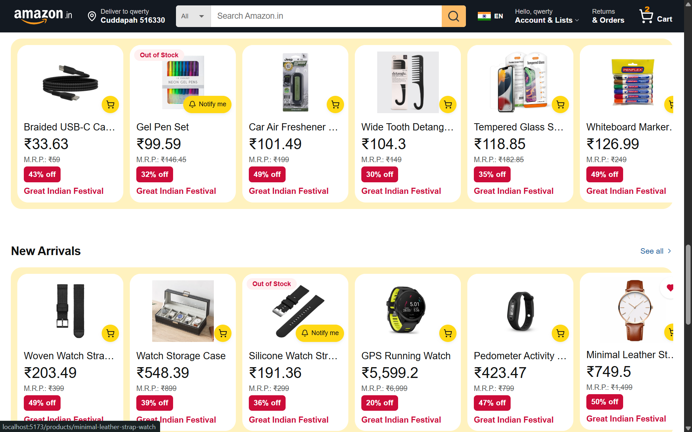

# E-Commerce Platform

A full-stack e-commerce application with an Amazon.in-inspired storefront, customer accounts, cart, checkout and an admin dashboard. Built with React, Express, PostgreSQL and Prisma.

## Homepage screenshots

### Festival carousel and discovery collections


### Product collections and new arrivals



Screenshots supplied from the local development app. Promotional text in the reference artwork is illustrative and does not establish bank offers or cashback support. “Notify me” is a demo-only interaction, not a stock notification service.

## Features

- **Storefront:** responsive layouts, festival carousel, categories, live search suggestions, catalog filters, sorting, product details and reviews.
- **Customer accounts:** registration, sign-in, profile management, saved addresses and wishlist.
- **Shopping:** cart quantity controls, stock checks, address selection, Cash on Delivery and Razorpay online checkout.
- **Orders:** order history, tracking, cancellation and invoice printing.
- **Administration:** product and image management, order processing, user roles, inventory alerts and system health views.
- **Infrastructure:** request validation, refresh token rotation, structured logs, health probes, automated tests and container configuration.

## Tech stack

| Area | Technologies |
| --- | --- |
| Frontend | React 19, Vite 6, Tailwind CSS 4, Radix UI, React Router 7 |
| State and data | TanStack Query, Zustand, Axios, React Hook Form, Zod |
| Backend | Node.js, Express 5, Prisma 6, PostgreSQL |
| Integrations | Razorpay, Cloudinary, postal PIN lookup |
| Testing and delivery | Vitest, React Testing Library, Supertest, Docker, Nginx, GitHub Actions |

## Project structure

```text
E_commerce/
├── Backend/
│   ├── src/
│   │   ├── config/          # Environment, database and integrations
│   │   ├── routes/          # API endpoints
│   │   ├── controllers/     # HTTP requests and responses
│   │   ├── services/        # Business logic
│   │   ├── middleware/      # Authentication, validation and errors
│   │   ├── validators/     # Request schemas
│   │   ├── utils/          # Shared helpers
│   │   ├── app.js          # Express application
│   │   └── server.js       # Server lifecycle
│   ├── prisma/             # Schema, migrations and seed data
│   ├── tests/              # Backend tests
│   ├── scripts/            # Catalog and image maintenance
│   └── uploads/            # Local image storage fallback
├── Frontend/
│   ├── public/             # Static assets
│   └── src/
│       ├── components/     # Shared and feature-specific UI
│       ├── pages/          # Storefront, account and admin screens
│       ├── api/            # Shared API client
│       ├── services/       # Feature API access
│       ├── store/          # Zustand stores
│       ├── hooks/          # Reusable React hooks
│       ├── test/           # Tests and helpers
│       ├── App.jsx         # Application routes
│       └── main.jsx        # React entry point
├── Docs/                   # Requirements, plans and screenshots
├── scripts/                # Development launcher and document tooling
├── .github/workflows/      # Continuous integration
├── docker-compose.yml      # Container services
└── AGENTS.md               # Project memory and guidelines
```

## Local setup

Use Node.js 24 (the backend container baseline), npm and a running PostgreSQL instance.

### 1. Install dependencies

From the project root:

```sh
npm install --prefix Backend
npm install --prefix Frontend
```

### 2. Configure the backend

Copy `Backend/.env.example` to `Backend/.env`. In PowerShell:

```powershell
Copy-Item Backend/.env.example Backend/.env
```

Update these settings:

| Setting | Configuration |
| --- | --- |
| `DATABASE_URL` | Your PostgreSQL database connection string |
| `PORT` | `5000`, matching the frontend development proxy |
| `FRONTEND_URL` | `http://localhost:5173`, or the actual Vite origin |
| `JWT_SECRET`, `JWT_REFRESH_SECRET` | Different random secrets; use at least 32 characters each |
| Razorpay credentials | Configure key ID, key secret and webhook secret together for online payments; omit all three for local COD-only use |
| Cloudinary credentials | Configure all three together, or omit all three for local image storage |

Replace or remove the integration placeholders in the template. Keep actual credentials in local environment files.

### 3. Prepare the database

With PostgreSQL running and `DATABASE_URL` configured:

```sh
npm run db:generate --prefix Backend
npm run db:migrate --prefix Backend
npm run db:seed --prefix Backend
```

The basic seed adds demo data; it does not recreate the full catalog shown in the screenshots.

### 4. Start the app

```sh
npm run dev
```

This starts the backend with nodemon and the frontend with Vite in one terminal, then opens the storefront in your default browser. Typical addresses:

- Storefront: `http://localhost:5173`
- API: `http://localhost:5000/api`

If 5173 is occupied, use the actual available Vite URL printed in the terminal. Press **Ctrl+C** once to stop both launched servers. The launcher does not start PostgreSQL, install packages or run migrations.

Terminal output uses cyan `[frontend]` labels and magenta `[backend]` labels. Frontend request logs show method, path, status and duration; query strings are omitted. Proxied requests appear in both servers' logs. Warning/error colors and phone QR output are retained, and labels remain readable when output is redirected.

To run just one server:

```sh
npm run dev --prefix Backend
npm run dev --prefix Frontend
```

Automatic browser opening is enabled by the root launcher. Frontend-only startup keeps its existing browser behavior. If PowerShell blocks `npm.ps1`, use `npm.cmd` instead of `npm`.

### Phone preview

Keep both servers running and connect your phone to the same Wi-Fi as your computer. Scan the network QR printed by Vite; it uses the actual available port. See [frontend development instructions](Frontend/README.md) for network and firewall guidance.

## Checks and builds

Run from the project root:

```sh
npm test --prefix Backend
npm test --prefix Frontend
npm run build --prefix Frontend
npm run lint --prefix Backend
npm run db:validate --prefix Backend
```

Backend tests may need a configured database depending on the suite. These are available commands, not a claim of a fresh application test run for this documentation update.

## Docker

Compose provides PostgreSQL, the Express API and the frontend served through Nginx. Copy `.env.production.example` to a root `.env` and replace its placeholders, including distinct JWT secrets and the required Razorpay credentials.

```sh
docker compose up -d --build
```

The default frontend address is `http://localhost`. Compose currently uses PostgreSQL 16 Alpine. Review the environment template and Compose configuration before deployment.

## Documentation

- [Requirements specification](Docs/SRS_FINAL.md) and [PDF edition](Docs/SRS_FINAL.pdf)
- [Frontend plan](Docs/FRONTEND_PLAN.md)
- [Design system](Docs/DESIGN_SYSTEM.md)
- [Implementation status](Docs/IMPLEMENTATION_STATUS.md)
- [Backend plan](Docs/Backend/ecommerce_backend_plan.md)
- [Frontend development and phone preview](Frontend/README.md)
- [Project memory and guidelines](AGENTS.md)

The SRS records requirements and acceptance mappings. Faculty approval and application acceptance test execution remain separate from document preparation.
